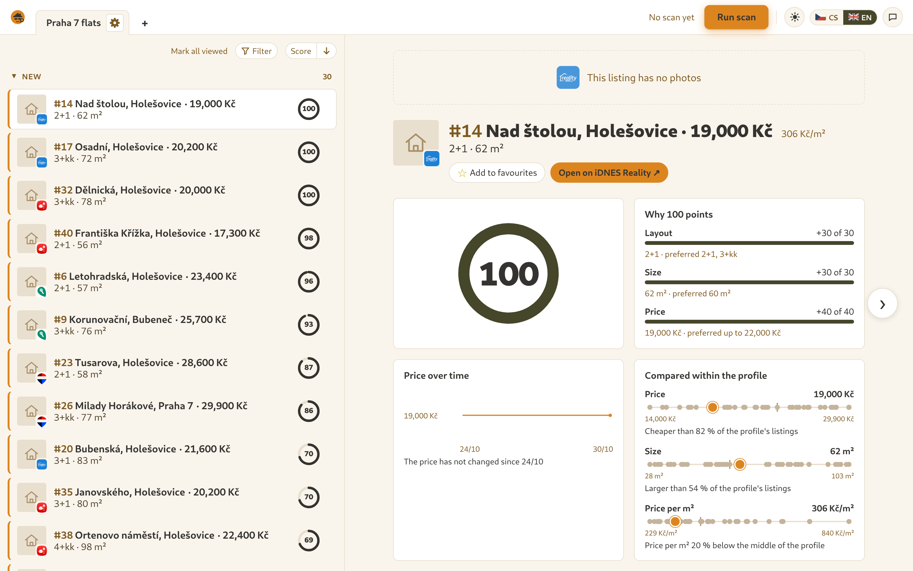
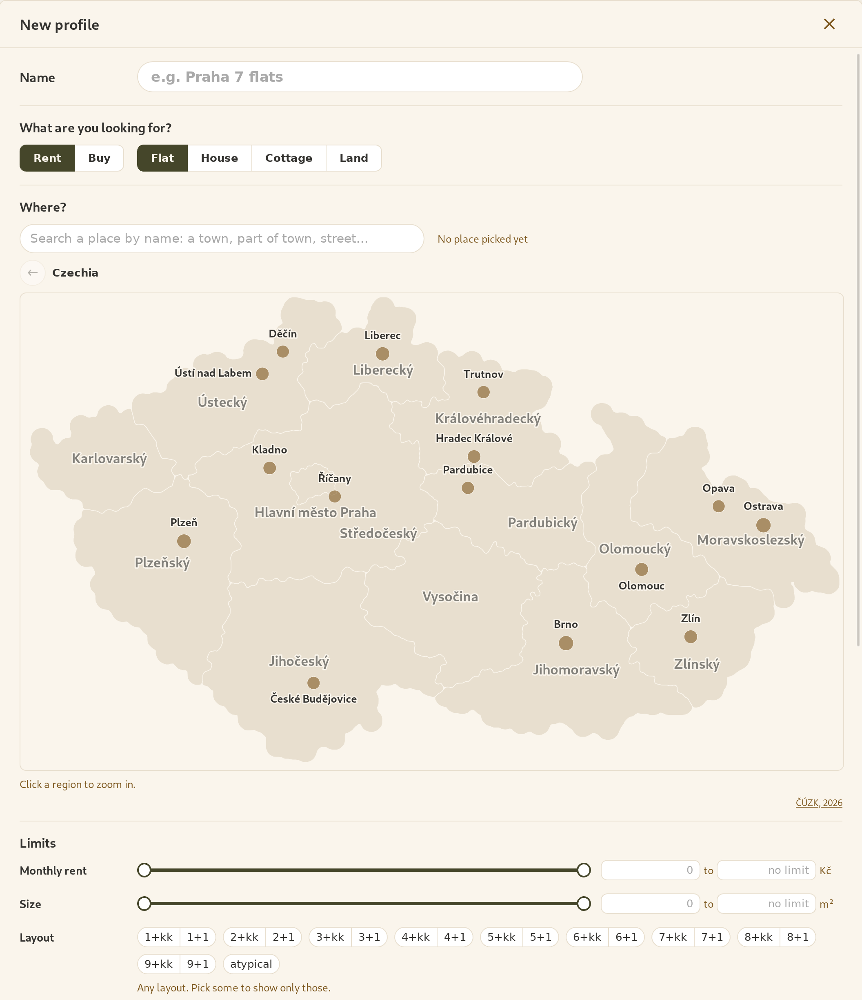
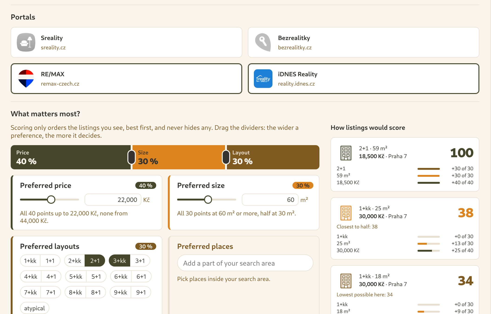
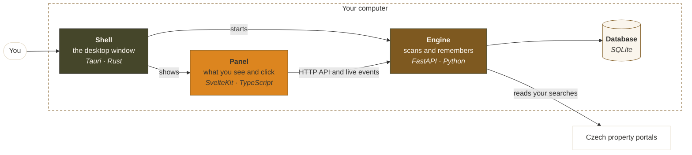

  

<h1 align="center">rentczecher</h1>

  Your home search across the Czech property portals, 
  in one inbox on your own computer.

  
  
  
  

  <a href="https://rentczecher.cz">rentczecher.cz</a>

<picture>
  <source media="(prefers-color-scheme: dark)" srcset="site/static/screenshots/inbox-en-dark.webp">
  
</picture>

## What it does

- **One search, every portal.** Say once what you are looking for: rent or
  buy, a flat, house, cottage or land, where, and for how much. rentczecher
  asks the Czech property portals for you.
- **Each flat once.** A flat posted on several portals shows up once, with a
  link to each posting.
- **New listings and price drops.** New ones stay marked until you open them,
  and every flat keeps its price history.
- **Ranked your way.** Tell it what matters most, such as the layout, the
  size, the price or the area, and each listing gets a score from 0 to 100
  with the reasons behind it.
- **Yours alone.** No account, no cloud, no tracking. Your searches and
  history stay on your computer.
- **Czech or English, light or dark.**

## Built around profiles

Everything in rentczecher hangs on a **profile**: one search of yours, saved
and watched for you. Keep as many as you need, say flats to rent in Praha 7
and a cottage to buy near the Šumava, and each one runs on its own.

A profile has three parts:

- **Criteria** decide what shows up at all: rent or buy, the type of property,
  the place, the price and size ranges, the minimum land and the layouts you
  accept. A listing that misses one never appears.
- **Portals** are the sites it asks. Most are on from the start. A portal that
  asks apps not to read it stays off until you turn it on.
- **Preferences** decide the order. Say what matters, such as a price, a size,
  a layout or particular places, and how much each one counts. They rank what
  the criteria let through and never hide anything.

Every scan runs for a profile, and each profile keeps its own inbox: every
flat it has found, what is new since you last looked, what you opened and
starred, and how each price has moved.

## Download

Installers for Windows, macOS (Apple silicon) and Linux (AppImage and .deb)
are on the [Releases page](https://github.com/schrodlm/rentczecher/releases/latest).

The first releases are not code-signed yet, so your system warns you before
the first start:

- **Windows:** choose *More info*, then *Run anyway*.
- **macOS:** open *System Settings*, then *Privacy & Security*, and choose
  *Open Anyway*.

Create a profile, pick the portals, and press **Run scan** whenever you want
fresh listings.

## How it uses the portals

rentczecher is independent, and not affiliated with any of the portals it
reads. It is made for your own home search. It reads the portals only for
your searches, from your computer, names itself in every request, and never
republishes what it reads. A portal that asks apps not to read its site stays
off until you turn it on in a profile.

[Which portals it reads, and how](docs/using-the-portals.md)

  <picture>
    <source media="(prefers-color-scheme: dark)" srcset="site/static/screenshots/search-en-dark.webp">
    
  </picture>
  <picture>
    <source media="(prefers-color-scheme: dark)" srcset="site/static/screenshots/preferences-en-dark.webp">
    
  </picture>

## How it works

The app is three parts, all running on your computer:

- The **shell** is the window you open. It starts the engine in the background
  and shows the panel inside itself.
- The **panel** is the interface: the inbox, the profile editor, the scores.
  It talks to the engine and never to the portals.
- The **engine** does the work. It searches the portals for each profile,
  recognises the same flat on several of them, and keeps the history in a
  database on your disk.

## Contributing

rentczecher is a Python engine, a SvelteKit panel and a Tauri desktop shell.
[CONTRIBUTING.md](CONTRIBUTING.md) covers the setup and how work is done here,
[docs/architecture.md](docs/architecture.md) how the parts fit together, and
the [glossary](CONTEXT.md) the words the code uses.

Running the engine on its own, without the desktop app, is described in
[docs/cli.md](docs/cli.md).

## License

rentczecher is free software under the
[GNU General Public License, version 3 or later](LICENSE). The license covers
the code. The name and the logo are not part of it, so a fork is welcome under
a name of its own.

Place data: **ČÚZK, 2026**, [CC BY 4.0](https://creativecommons.org/licenses/by/4.0/deed.cs),
modified. [Details](docs/data.md)

Street maps: © [OpenStreetMap](https://www.openstreetmap.org/copyright) contributors.
