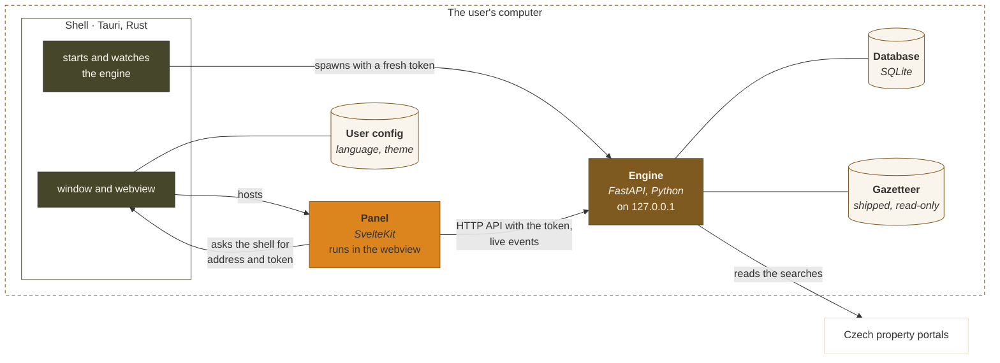

# Architecture

rentczecher is three programs that run together on the user's computer. This
page shows how they fit and talk. Each part's inside is described in its own
`ARCHITECTURE.md`:

- [engine/ARCHITECTURE.md](../engine/ARCHITECTURE.md)
- [panel/ARCHITECTURE.md](../panel/ARCHITECTURE.md)
- [shell/ARCHITECTURE.md](../shell/ARCHITECTURE.md)

The words used here are defined in the [glossary](../CONTEXT.md), and the
decisions behind the design are the [ADRs](adr/).

## The three parts

| Part | Job | Built with |
|---|---|---|
| **Shell** | The desktop window. Starts the engine, hosts the panel, owns everything the operating system provides. | Tauri 2, Rust |
| **Panel** | The interface: the inbox, the detail, the profile editor, the scores. | SvelteKit, TypeScript, static build |
| **Engine** | Scans the portals, recognises the same flat across them, keeps the history, and serves it all through an HTTP API. | Python, FastAPI, SQLite |

The engine knows nothing about the shell or the panel. It is a program with
an API, and the panel is one client of it. The same engine also runs on its
own as a command, see [cli.md](cli.md).

## Starting up

1. The shell makes a fresh 32-byte secret for this launch. It is never
   written anywhere.
2. It starts the engine as `serve --port 0 --exit-with-parent`, with the
   secret in the environment and the window's origin allowed for requests.
3. The engine picks a free port on `127.0.0.1` and prints it as a `PORT=`
   line. The shell reads it and waits for `/v1/health` to answer.
4. The panel asks the shell, through a Tauri command, for the engine's address
   and the secret. Every request it then sends carries the secret as a bearer
   token, and the engine rejects any request without it. The event stream
   also takes it as a query parameter, since a browser's event source cannot
   set headers.
5. When the shell closes, the engine notices its parent is gone and exits.

So the engine listens only on the loopback interface, only the window that
started it holds the secret, and a new launch gets a new one.

## How the panel talks to the engine

- **The API** is versioned under `/v1`: profiles, their tracked properties,
  viewed and starred marks, places, runs, health. Its contract is
  [api/openapi.json](api/openapi.json), generated from the engine's code. The
  panel's types are generated from that file, so a change to the API that the
  panel does not follow fails the panel's type check.
- **Live events** come over `/v1/events` as server-sent events, so the panel
  sees a scan start, each portal finish and the scan end without asking.

## A scan, end to end

1. The user presses **Run scan**. The panel posts the profile to `/v1/runs`,
   and the engine queues a run for it.
2. For each portal the profile scans, the engine translates the profile's
   search place into that portal's own ids, using the gazetteer, and reads the
   result pages.
3. Listings that miss the criteria are dropped. The rest are located: their
   address text becomes official RÚIAN places.
4. Listings of the same flat from different portals are matched, pairwise,
   and each flat becomes one property.
5. The engine stores the outcome: new listings, prices, which listings went
   missing. It then forgets what no profile follows any more.
6. It announces the run on the event stream, and the panel reloads the inbox.

Scoring is not in this list. The engine stores the preferences, and the panel
scores the listings when it shows them.

## Where the data lives

| | Where | Written by |
|---|---|---|
| Database: profiles, listings, properties, price history | the user's data folder, see [cli.md](cli.md#where-the-data-lives) | engine |
| Photos: one file per stored photo | the same data folder, in `photos/` | engine |
| Gazetteer: every Czech place and the portals' ids for them | inside the engine, read-only | built by a script, see [development.md](development.md#the-gazetteer) |
| User config: language and theme | the operating system's config folder | shell, for the panel |
| Nearby kinds: which kinds of place each profile shows | the window's local storage | panel |
| Profiles file: chosen profiles, to move them to another computer | wherever the user saves it | shell, for the panel |

## Where the engine comes from

The shell starts the engine from one of two places, and nothing else about the
app changes:

- **A development build** runs the engine straight from its source with uv,
  so engine edits show on the next launch.
- **A release** runs the engine frozen with PyInstaller into a folder the
  installer carries, so the user needs no Python. The panel is a static build
  inside the shell.

Either way, the shell is the only way the app is started. How to run it while
working on it is in [CONTRIBUTING.md](../CONTRIBUTING.md#running-the-app).

## The decisions

| ADR | Decision |
|---|---|
| [1](adr/0001-the-shell-is-the-only-doorway.md) | The shell is the only doorway, in development and in release |
| [2](adr/0002-openapi-fetch-binds-the-panel-to-the-contract.md) | The panel is bound to the API's contract through generated types |
| [3](adr/0003-the-sidecar-ships-as-a-folder-bundle.md) | The frozen engine ships as a folder |
| [4](adr/0004-the-engine-is-one-package-every-interface-a-client.md) | The engine is one package, and every interface is a client |
| [5](adr/0005-the-desktop-app-is-a-tauri-shell-over-a-python-sidecar.md) | The desktop app is a Tauri shell over a Python sidecar |
| [6](adr/0006-dedup-matches-pairs-and-never-groups-transitively.md) | Dedup matches pairs and never groups transitively |
| [7](adr/0007-a-scan-notifies-before-it-commits.md) | A scan notifies before it commits, superseded by ADR 10 |
| [8](adr/0008-places-are-ruian-units-resolved-offline.md) | Places are RÚIAN units, resolved offline |
| [9](adr/0009-local-first.md) | Local-first: no accounts, no cloud, no mobile |
| [10](adr/0010-notification-channels-are-api-clients.md) | Notification channels are API clients |
| [11](adr/0011-scoring-belongs-to-clients.md) | Scoring belongs to the clients |
| [12](adr/0012-one-private-copy-per-person.md) | One private copy per person |
| [13](adr/0013-photos-are-fetched-as-a-person-looks.md) | Photos are fetched as a person looks |
