# Engine architecture

The engine is the part of rentczecher that does the work. It reads the
portals for each profile, works out which listings are the same flat, keeps
the history in SQLite, and serves all of it through an HTTP API. It knows
nothing about the window or the interface: the panel is one client of its API,
and the `rentczecher` command is another. How it sits next to the shell and the
panel is in [docs/architecture.md](../docs/architecture.md).

## Layout

One Python package, `rentczecher_engine`, in light hexagonal layers:

| Layer | Holds | May import |
|---|---|---|
| `domain/` | The model: profiles, listings, properties, places, prices. Plain frozen dataclasses, no I/O. | nothing else |
| `services/` | What the engine does: the scan pipeline and its steps. | `domain/` |
| `adapters/` | The edges: the portals, the database, the gazetteer, the HTTP API. | everything |
| `cli/` | The `rentczecher` command, which wires adapters to services. | everything |

`services/` reaches the database, the network and the gazetteer only through
protocols it defines, which the adapters satisfy. `tests/test_layering.py`
parses every import and fails on a violation, so the layers cannot quietly
erode.

## The model

Three ideas carry the whole engine. The [glossary](../CONTEXT.md) defines each
precisely.

- **A listing is one portal's posting. A property is the flat itself.** The
  same flat on two portals is one property with two listings. Listings are
  facts shared by every profile. What a profile did with a flat, such as
  viewing or starring it, is that profile's own tracking.
- **Places are official RÚIAN units, resolved offline.** A profile searches a
  place by its RÚIAN kind and code, never by a name. A listing's location text
  is turned into the same units with the gazetteer, a SQLite file the engine
  ships, so locating needs no network
  ([ADR 8](../docs/adr/0008-places-are-ruian-units-resolved-offline.md)).
- **Portal knowledge stays in its scraper.** Each portal has one scraper that
  translates the profile's search into that portal's request, and its answer
  back into plain listings. Nothing after the scraper knows anything about a
  portal beyond its name.

## A scan

```mermaid
flowchart LR
    profile["Profile"] --> scrape["Scrape<br><i>one scraper per portal</i>"]
    scrape --> filter["Filter<br><i>the criteria</i>"]
    filter --> locate["Locate<br><i>text to RÚIAN places</i>"]
    locate --> dedup["Dedup<br><i>same flat, pairwise</i>"]
    dedup --> store["Store<br><i>new, prices, missing</i>"]
    store --> prune["Prune<br><i>forget the untracked</i>"]

    classDef step fill:#7e5920,stroke:#45462a,color:#faf5ec
    classDef start fill:#faf5ec,stroke:#7e5920,color:#343330
    class scrape,filter,locate,dedup,store,prune step
    class profile start
```

`services/pipeline.py::run_profile` is the whole scan. The API's run manager
calls it when the panel asks for a scan, and the CLI calls it for every
profile that is not paused.

1. **Scrape.** Every portal the profile uses is scraped on its own. A portal
   that fails, or answers in a shape its scraper no longer understands, is
   recorded as broken, and the others still run.
2. **Filter.** Listings that miss the criteria are dropped. A listing that
   does not state its size is not dropped for it, since the portal simply did
   not say.
3. **Locate.** Each listing's location text becomes RÚIAN places. A name that
   could mean two places resolves to nothing rather than to a guess.
4. **Dedup.** Listings from different portals are scored pair by pair on GPS
   distance, a shared place, the layout, the price and the size. Only a
   confident pair merges into one property. Pairs are never chained, so A
   matching B and B matching C never makes A the same as C
   ([ADR 6](../docs/adr/0006-dedup-matches-pairs-and-never-groups-transitively.md)).
5. **Store.** New listings, new prices and missed listings are written in one
   transaction. A listing counts as gone only after three scans in a row
   without it, to ride out portals that flicker.
6. **Prune.** Tracking not renewed for 90 days is forgotten, unless the flat is
   starred, and properties no profile tracks any more are deleted
   ([ADR 12](../docs/adr/0012-one-private-copy-per-person.md)).

A scan always commits. Nothing waits on a notification, since channels are
API clients that keep their own record of what they delivered
([ADR 10](../docs/adr/0010-notification-channels-are-api-clients.md)). A dry run
does everything but write.

The engine stores each profile's preferences but never scores. Scoring
belongs to the clients
([ADR 11](../docs/adr/0011-scoring-belongs-to-clients.md)).

## The API

`adapters/api/` is a FastAPI app, started by `rentczecher serve`. It binds to
`127.0.0.1` only and requires the launch's token on every route. Scans run one
at a time on a worker thread, and their progress goes out as server-sent
events on `/v1/events`. The contract is generated into
[docs/api/openapi.json](../docs/api/openapi.json), and a commit hook fails when
the file and the code disagree.

## Storage

SQLite, with numbered migrations in
`adapters/repositories/sqlite/migrations/` that apply on startup. The tables
are described in [SCHEMA.md](SCHEMA.md). The repositories spell out every
column and map every row by name, and the caller of a repository owns the
transaction, so one unit of work is one commit.

## Where to look

| To change | Start in |
|---|---|
| How a portal is read | `adapters/scrapers/<portal>.py`, and its notes in [docs/portals/](../docs/portals/) |
| Which places can be searched, and how text becomes a place | `adapters/geocoding/gazetteer.py`, [docs/places.md](../docs/places.md), [docs/locating.md](../docs/locating.md) |
| When two listings are the same flat | `services/dedup.py`. Its weights are calibrated, so move them only with boundary tests. |
| What is stored | `adapters/repositories/sqlite/`, [SCHEMA.md](SCHEMA.md) |
| What the API offers | `adapters/api/routes/` |
| The order of a scan's steps | `services/pipeline.py` |
